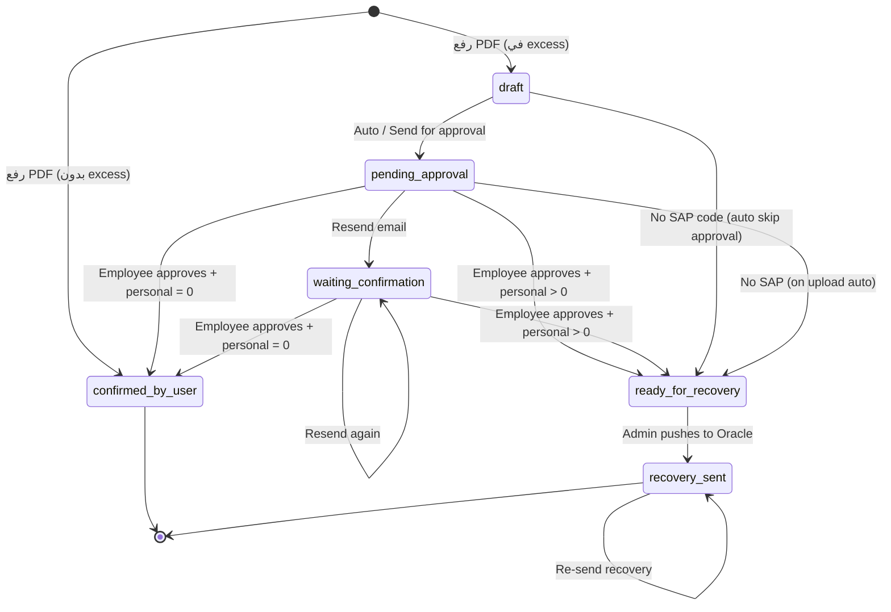

# eBilling — System Flow & How It Works

> **NEWEAST · Etisalat SIM Billing**  
> آخر تحديث: يونيو 2026  
> URL: `https://ebilling.neweast.cloud/ebilling/`

---

## 1. نظرة عامة

**eBilling** نظام لإدارة فواتير خطوط **e& (Etisalat)** للموظفين:

1. رفع PDF الفاتورة → استخراج البيانات تلقائياً
2. مقارنة الفاتورة مع **Package** الموظف في SIM Master
3. إذا في **Excess** (تجاوز) → إرسال للموظف للموافقة وتقسيم Official / Personal
4. بعد الموافقة → **Recovery** إلى **Oracle HCM** (خصم Personal من الراتب)
5. تقارير، Dashboard، صلاحيات، و Audit

```
┌─────────────┐     ┌──────────────┐     ┌─────────────┐     ┌──────────────┐
│  HR Admin   │────▶│   eBilling   │────▶│  Employee   │────▶│ Oracle HCM   │
│  Upload PDF │     │  API + UI    │     │ Folder Link │     │  Recovery    │
└─────────────┘     └──────────────┘     └─────────────┘     └──────────────┘
```

---

## 2. البنية التقنية

| المكوّن | المسار / العنوان |
|---------|------------------|
| **واجهة المستخدم** | `/home/negt/RecTracking/client/dist/` → `/var/www/mis-dashboard/ebilling/` |
| **API (NestJS)** | `/home/negt/RecTracking/server/dist/` — Port **5041** — `pm2 rectracking-api` |
| **قاعدة البيانات** | PostgreSQL `rectracking` |
| **Auth** | Microsoft OAuth (JWT في localStorage) |
| **Parser** | Claude + fallback Etisalat PDF parser |

---

## 3. المستخدمون والصلاحيات

### 3.1 Super Admin (أدوات كاملة)

هؤلاء يملكون صلاحية **E-bill Approval** و Recovery و Permissions:

- `sakour@neweast.co` / `.com`
- `guru@neweast.com` / `.co`
- `ashwin@neweast.co` / `.com`
- `henry@neweast.co`

### 3.2 صلاحيات التبويبات (Permissions)

تُخزَّن في جدول `ebilling_user_permissions`:

| Key | التبويب |
|-----|---------|
| `dashboard` | Dashboard |
| `invoices` | Invoices |
| `master` | Master (SIM) |
| `analysis` | Analysis |
| `audit_log` | Users Log |
| `recovery_log` | Recovery |

- **إضافة من Oracle:** اختيار موظف من `sim_employees`
- **إضافة External:** أي إيميل عمل بدون ربط Oracle — ثم تحديد الصلاحيات من الجدول
- **Default** للمستخدم الجديد: Dashboard + Invoices + Master + Reports

> ملاحظة: صلاحيات التبويبات تتحكم بالـ **UI**؛ معظم الـ API endpoints تتطلب JWT فقط (Super Admin مطلوب للعمليات الحساسة).

---

## 4. مفاهيم أساسية

| المصطلح | المعنى |
|---------|--------|
| **Package Total** | قيمة الباقة المسموحة للموظف (من SIM Master) |
| **Invoice Total** | المبلغ الإجمالي في PDF |
| **Exceeded Amount** | `Invoice − Package` (إذا > 0) |
| **Official Usage** | جزء التجاوز **رسمي/شركة** |
| **Personal Usage** | جزء التجاوز **شخصي** → يُرحَّل لـ Oracle |
| **Excess (في الجدول)** | حسب الحالة: عادة = Personal أو Exceeded Amount |
| **SAP / person_number** | رقم الموظف في Oracle — **مطلوب للـ Recovery** |
| **approval_token** | UUID لرابط الموافقة العام `/ebilling/folder/:token` |

**قاعدة التقسيم:** `Official + Personal = Exceeded Amount`

---

## 5. دورة حياة الفاتورة (Approval Status)



| الحالة | المعنى | يظهر في |
|--------|--------|---------|
| `draft` | مرفوعة، فيها excess، لم يُرسل إيميل بعد | Invoices grid |
| `pending_approval` | إيميل أُرسل، بانتظار الموظف | Pending Approval |
| `waiting_confirmation` | تم Resend — `(N)` = عدد الإرسالات | Pending Approval |
| `confirmed_by_user` | بدون excess أو الموظف أكّد (personal = 0) | — |
| `ready_for_recovery` | موافق عليها، جاهزة Oracle | Ready for Recovery |
| `recovery_sent` | تم الترحيل لـ Oracle | Recovery log |

---

## 6. Flow كامل — من الرفع للـ Recovery

### المرحلة 1: رفع PDF

**المسار:** Invoices → Upload (drag-drop أو folder)

```
PDF → Parser (Claude / Etisalat)
    → استخراج: phone, amount, month, invoice code...
    → البحث في sim_employees بالرقم
```

**ثلاث نتائج:**

| النتيجة | ماذا يحدث |
|---------|-----------|
| **unknown_phone** | الرقم غير موجود في Master → Pending upload → HR يسجّله يدوياً |
| **success (no excess)** | `confirmed_by_user` + إيميل تأكيد للموظف |
| **success (has excess)** | → **autoProcessAfterUpload** (المرحلة 2) |

- Folder كبير (200 PDF): يُعالَج **دفعة واحدة** داخلياً بـ batches من 20
- Bulk upload: نفس المنطق

---

### المرحلة 2: المعالجة التلقائية بعد الرفع

**الدالة:** `autoProcessAfterUpload`

```
Exceeded = Invoice Total − Package Total

IF Exceeded ≤ 0:
    → approval_status = confirmed_by_user
    → إيميل تأكيد للموظف

ELSE IF Exceeded > 0:

    IF person_number (SAP) فارغ:
        → approval_status = ready_for_recovery
        → personal_usage = Exceeded, official = 0
        → بدون إيميل موافقة (تخطي الموظف)

    ELSE (SAP موجود):
        → approval_token = UUID جديد
        → approval_status = pending_approval
        → approval_email_count = 1
        → إيميل + رابط Folder للموظف
```

---

### المرحلة 3: موافقة الموظف (Folder)

**رابط عام (بدون login):**  
`https://ebilling.neweast.cloud/ebilling/folder/{token}`

**API:**
- `GET /invoices/folder/:token` — عرض الفاتورة
- `POST /invoices/folder/:token/submit` — إرسال التقسيم + Remarks

**الموظف يدخل:**
- Official amount (AED)
- Personal amount (AED)
- Remarks (اختياري) → `employee_remarks`

**بعد Submit:**
```
IF personal_usage > 0  → ready_for_recovery
IF personal_usage = 0  → confirmed_by_user
→ إيميل تأكيد للموظف
→ HR يرى التحديث في E-bill Approval sidebar
```

**Remarks:**
- `employee_remarks` — من الموظف (Folder)
- `admin_remarks` — من HR (جدول Invoices)
- العرض المدمج: `Employee: ...` / `HR: ...`

**حالة خاصة:** إذا وافق سابقاً بدون Remarks → يمكن حفظ Remarks لاحقاً من نفس الرابط.

---

### المرحلة 4: HR — E-bill Approval Panel

**Sidebar يمين** (Super Admin فقط):

| القسم | المحتوى |
|-------|---------|
| **Pending Approval** | `pending_approval` + `waiting_confirmation` |
| **Ready for Recovery** | `ready_for_recovery` |

**أزرار:**
- **Open** — فتح Folder أو Invoices
- **Resend** — إعادة إيميل → `waiting_confirmation (N)`
- **Recovery** — ترحيل Oracle (إذا SAP + personal > 0)

**تحديث تلقائي:** كل 20 ثانية + عند أي upload / send / grid refresh

---

### المرحلة 5: Recovery → Oracle

**المتطلبات:**
- `approval_status = ready_for_recovery`
- `personal_usage > 0`
- `person_number` موجود في SIM Master

**الخطوات:**
1. **Preview** — مطابقة Master vs Oracle (`GET .../recovery-preview`)
2. **Push** — `POST .../push-recovery`
3. النجاح → `recovery_sent`, `recovery_status = sent`, `recovery_sent_at`

**الفشل:** `recovery_status = failed` + `recovery_last_error`

---

## 7. الإيميلات

| الحدث | المستلم | CC |
|-------|---------|-----|
| تأكيد بدون excess | `sim_employees.email` | sakour + end.bill |
| طلب موافقة Folder | الموظف | نفس CC |
| تأكيد بعد الموافقة | الموظف | نفس CC |
| Resend | الموظف | نفس CC |

- الشعار: NEWEAST wordmark
- المرفقات: PDF الفاتورة عند طلب الموافقة
- `approval_email_count` يُزاد عند كل إرسال

---

## 8. Dashboard — الإحصائيات

| Card | المصدر |
|------|--------|
| Pending approval | `approval_status = pending_approval` |
| Waiting confirmation | `waiting_confirmation` |
| Ready for recovery | `ready_for_recovery` |
| Approval emails sent | `SUM(approval_email_count)` |

+ إحصائيات SIM Master، Billing totals، Top excess

---

## 9. SIM Master (Master Tab)

- بيانات الموظف: الاسم، الرقم، Email، Package، **person_number (SAP)**
- Import من Oracle / Excel
- **person_number** حاسم: بدونه → تخطي الموافقة → Ready for Recovery مباشرة

---

## 10. جداول قاعدة البيانات الرئيسية

| الجدول | الغرض |
|--------|--------|
| `sim_employees` | Master بيانات الخطوط |
| `invoices` | الفواتير + approval + recovery |
| `monthly_remarks` | employee_remarks + admin_remarks |
| `email_logs` | سجل الإيميلات |
| `ebilling_user_permissions` | صلاحيات المستخدمين |
| `ebilling_audit_logs` | Audit trail |
| `invoice_pending_uploads` | PDFs برقم غير معروف |

**أعمدة invoices المهمة:**
- `approval_status`, `approval_token`, `approval_sent_at`, `approval_submitted_at`
- `approval_email_count`
- `personal_usage`, `official_usage`
- `recovery_status`, `recovery_sent_at`, `recovery_last_error`
- `oracle_recovery_ref` (JSON)

---

## 11. API Endpoints — مرجع سريع

| Method | Path | الوصف |
|--------|------|--------|
| POST | `/invoices/upload` | رفع PDF واحد |
| POST | `/invoices/upload-bulk` | رفع متعدد |
| GET | `/invoices/grid?month=` | جدول الشهر |
| GET | `/invoices/approvals/queue` | Pending + Ready (Admin) |
| POST | `/invoices/:id/send-for-approval` | Resend / Send |
| POST | `/invoices/:id/push-recovery` | Oracle recovery |
| GET | `/invoices/folder/:token` | عرض Folder (public) |
| POST | `/invoices/folder/:token/submit` | موافقة موظف (public) |
| GET | `/permissions/users` | قائمة الصلاحيات |
| PUT | `/permissions/users` | حفظ صلاحيات |
| GET | `/dashboard` | إحصائيات |

---

## 12. سيناريوهات عملية

### سيناريو A — فاتورة بدون تجاوز
```
Upload → Parser → Exceeded = 0
→ confirmed_by_user
→ Email confirmation للموظف
→ انتهى
```

### سيناريو B — تجاوز + SAP + موافقة موظف
```
Upload → Exceeded > 0 + SAP موجود
→ pending_approval + email + folder link
→ Employee: Official 10 + Personal 3.49
→ ready_for_recovery
→ HR: Recovery → Oracle
→ recovery_sent
```

### سيناريو C — تجاوز بدون SAP
```
Upload → Exceeded > 0 + person_number فارغ
→ ready_for_recovery (فوراً)
→ personal = full exceeded
→ HR: Recovery (إذا أضيف SAP لاحقاً في Master)
```

### سيناريو D — Resend
```
HR: Resend
→ waiting_confirmation (2)
→ approval_email_count++
→ Employee يفتح الرابط ويوافق من جديد
```

### سيناريو E — External user permissions
```
Permissions → Add external email
→ consultant@neweast.co
→ تفعيل Invoices + Dashboard
→ يدخل بـ Microsoft OAuth بنفس الإيميل
```

---

## 13. Deploy & Restart

```bash
# UI
cp -r client/dist/assets/* /var/www/mis-dashboard/ebilling/assets/
cp client/dist/index.html /var/www/mis-dashboard/ebilling/

# API
pm2 restart rectracking-api --update-env
```

Migrations تُطبَّق تلقائياً عند تشغيل API.

---

## 14. ملخص Flowchart — End to End

```
                    ┌──────────────────┐
                    │   HR uploads PDF │
                    └────────┬─────────┘
                             │
              ┌──────────────┼──────────────┐
              ▼              ▼              ▼
        Unknown phone    No excess      Has excess
              │              │              │
              ▼              ▼              ▼
         Register SIM   confirmed      Has SAP?
         in Master      + email            │
                                    ┌──────┴──────┐
                                    NO            YES
                                    │              │
                                    ▼              ▼
                            ready_for_      pending_approval
                            recovery        + folder email
                                    │              │
                                    │              ▼
                                    │       Employee submits
                                    │       Official/Personal
                                    │              │
                                    └──────┬───────┘
                                           ▼
                                  ready_for_recovery
                                           │
                                           ▼
                                  HR: Push Recovery
                                           │
                                           ▼
                                    recovery_sent
                                    (Oracle HCM)
```

---

*Made By IT & Business Dept — NEWEAST eBilling Documentation*
